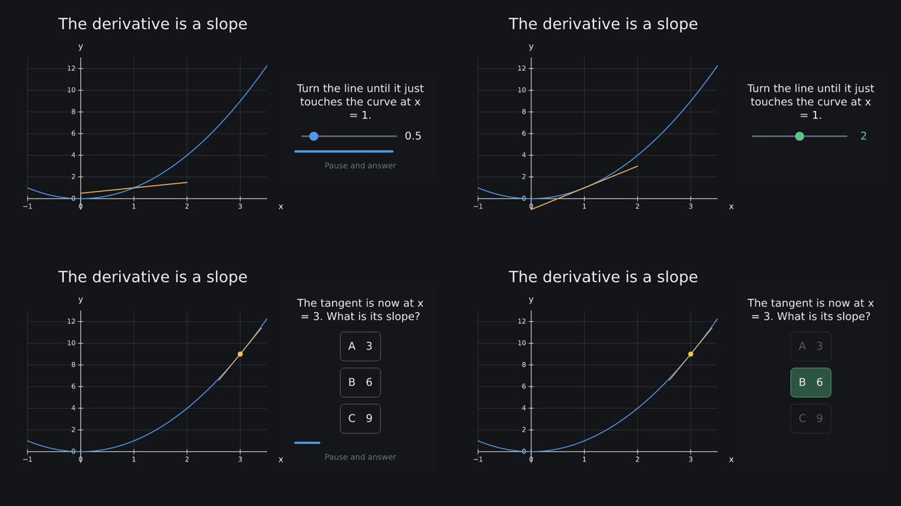
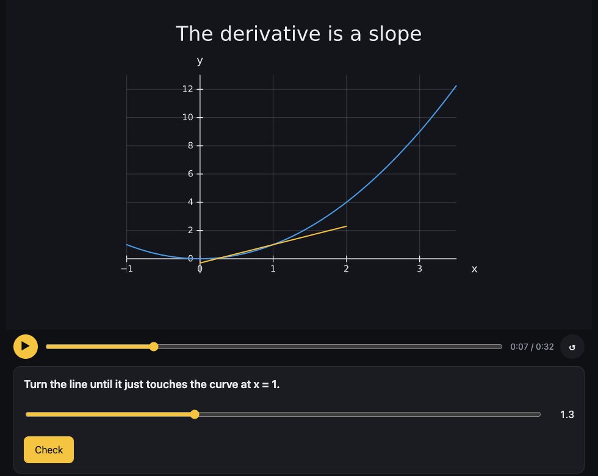

# Interactive lessons: questions, branches and the lesson player

A lesson is a scene that stops to ask. The learner answers by picking an option, moving a
slider, typing a number or dragging a point. What plays next depends on the answer: a hint and
another try, or the next step. The same file renders to a quiz video (the question on screen,
time to pause and think, then the answer), and `--format lesson` turns it into a page that
plays in any browser and can be embedded in a learning platform.

This guide covers:

- asking a question with `s.ask` and branching with `q.correct()` and `q.wrong()`;
- the kinds of answer, and answers the scene reacts to while the learner chooses;
- quiz videos: what a lesson's video shows at each question;
- answering in `kinemo dev`;
- exporting with `--format lesson`, and embedding the page with its event protocol;
- what can be interactive, and how lessons run on phones.

The complete example is [`examples/lessons/slope.py`](https://github.com/m4nd0r4s/kinemo/blob/main/examples/lessons/slope.py), the
derivative as a slope. It is published on the website as a
[playable lesson](https://m4nd0r4s.github.io/kinemo/lessons/slope/).

## A first question

```python
import kinemo as k


@k.scene
def first_question(s: k.Scene):
    formula = k.Math(r"f(x) = x^2", size=0.7).place(at=(0, 2))
    s.play(k.write(formula))
    q = s.ask("What is the slope of f at x = 2?", k.Choice(["2", "4", "8"]), correct="4")
    with q.wrong():
        hint = k.Text("Hint: the slope of x² is 2x.", size=0.45).place(below=formula, gap=0.6)
        s.play(k.write(hint))
        s.wait(1)
    with q.correct():
        yes = k.Text("Right: 2 · 2 = 4.", size=0.45).place(below=formula, gap=0.6)
        s.play(k.write(yes))
    s.play(formula.to(fill=k.YELLOW))
```

`s.ask(prompt, answer, correct=...)` stops playback at the cursor and shows the prompt with the
answer's controls. The player draws these in HTML beside the frame, not on the canvas. The
`with` blocks hold what plays after each kind of answer:

- `with q.correct():` plays after a right answer, then the lesson goes on.
- `with q.wrong():` plays after a wrong answer, then asks again. With
  `q.wrong(then="continue")`, the lesson goes on instead, which suits a branch that explains
  the answer.

Both blocks are optional. Without a correct branch, a right answer just goes on. Without a
wrong branch, a wrong answer is asked again at once. `name=` gives the question a stable id for
a host platform; the default ids are `q1`, `q2`...

## How branches work

A lesson is still one timeline, so every frame stays a pure function of time and everything in
this guide works inside branches (verbs, signals, `s.during`, sounds). The timeline is laid out
like this:

1. The question is an instant: the frame where playback stops.
2. Its branches are built one after the other right after it, in the order you write them.
   Each one starts from the state at the question: whatever a branch moved, added or removed
   is put back at the next branch's start.
3. After the last branch, the lesson continues from the state at the end of the correct
   branch, whichever order you wrote them in.

The player only decides which stretch plays next. A video plays the correct path, leaving
out the wrong branches; at each question it plays a quiz stretch that kinemo builds (see
[Quiz videos](#quiz-videos)).

Branches come right after their question (K1501 otherwise), and a branch cannot ask another
question. Ask the next one after the branches, as the example lesson does three times.

## Kinds of answer

An answer is one of the kinds that scene parameters use (see [Output](13-output.md#parameters)):

| Kind | The learner | `correct=` | `tolerance=` |
| --- | --- | --- | --- |
| `k.Choice(["2", "4", "8"])` | picks an option | an option, or a list of the options that count | — |
| `k.Float(lo, hi)` | moves a slider | a number | how far off still counts |
| `k.Float()` | types a number | a number | how far off still counts |
| `k.Int(lo, hi)` | moves a slider in whole steps | an integer | how far off still counts |
| `k.Point(default=(0, 0))` | drags a point on the frame (or types x and y) | `(x, y)` | distance that still counts |
| `k.Str()` | types a short text | a text, or a list of texts | — (case and spaces do not count) |

Mistakes are caught at build time:

- K0105: `correct=` is missing, not one of the options, or outside the slider's range.
- W1501: every answer counts as correct, so the wrong branch can never play.
- W1502: something started before the question is still moving when playback stops for it.
  The learner would see a frozen, half-finished move.

## Answers the scene reacts to

`s.answer(kind)` makes the answer before its question is asked, as a signal the scene can use.
While the learner moves the slider (or drags the point), the frame follows. The line below
turns as the slider moves, and the question checks the angle:

```python
import kinemo as k


@k.scene
def turn_the_line(s: k.Scene):
    angle = s.answer(k.Float(0, 90, default=10), name="angle")
    line = k.Line((-3, 0), (3, 0), rotate=angle, stroke=k.YELLOW).place(at="center")
    s.play(k.draw(line))
    q = s.ask("Turn the line to 45°.", angle, correct=45, tolerance=3)
    with q.correct():
        s.play(line.to(stroke=k.GREEN))
```

Until the learner answers, the signal holds the default (`default=`, else the low end). After
an answer, it keeps that answer. In a video it moves to the correct value when the quiz
reveals it (or takes it at the question, with `questions="answers"`).
`q.value` is the same signal, for a question whose answer kind was given directly.

A point the learner drags works the same way: `pick = s.answer(k.Point())`, then
`k.Dot(position=pick)`.

## Quiz videos

Rendered to video (`kinemo render lesson.py`), a lesson cannot wait for an answer, so each
question becomes a quiz. A band shows the prompt and the answer's controls, with "Pause and
answer" and a countdown of `think=` seconds (5 by default). Then the right answer is revealed,
and the video goes on along the correct branch. The reveal fits the kind of answer:

| Kind | During the countdown | The reveal |
| --- | --- | --- |
| `k.Choice` | The options as cards: A, B, C... | The right card turns green, the others dim |
| `k.Float()`, `k.Str()` | A box with "?" | The answer is written in |
| `k.Float(lo, hi)`, `k.Int` | A slider at the default | The knob slides to the answer, and the scene follows if it uses the answer (`s.answer`) |
| `k.Point` | Nothing on the band | A ring marks the right place, and the scene's point slides there |



The interactive player and the lesson page skip the quiz stretch: it only plays in video.
Settings:

- `s.ask(..., think=8)`: seconds to think.
- `s.ask(..., quiz_at="right")`: where the band goes: `"bottom"` (the default), `"top"`,
  `"left"` or `"right"` of the safe area. At a side, the options stack in a column.
- `@k.scene(questions="answers")`, or `kinemo render --questions answers`: no quiz. The video
  plays on along the correct path, each answer set at its question.

The band covers part of the frame while it is shown. W1503 reports text of the scene it
covers: put the band elsewhere, or make room for it, as the example lesson does by keeping its
axes on the left. W1504 reports a prompt that takes longer to read than `think=`.

## Answering in `kinemo dev`

The preview plays a lesson like the player does:

- Playback stops at each question, and a panel over the frame takes the answer. A slider or a
  dragged point moves the frame live.
- After the answer, playback follows the branch that answer takes.
- On the timeline, a "?" marks each question, and the branches are bands under the ruler:
  green for correct, red for wrong, blue for the quiz stretch a video plays. Click a band to
  play that stretch.

Scrubbing still moves freely across the whole timeline, branches included.

## Exporting a lesson

```bash
kinemo render lesson.py --format lesson                # out/<scene>/index.html
kinemo render lesson.py --format lesson --out site/lessons
python -m http.server -d out                           # then open http://localhost:8000/<scene>/
```



The folder plays anywhere static files can be served (GitHub Pages, a bucket, a school's
server). Browsers do not run its WebAssembly from a `file://` URL, so it needs a server. The
folder holds:

- `index.html`: the lesson, with the player (`player.js`, `player.css`, and the WebAssembly
  core in `pkg/`).
- `lesson.json`: the scene, plus the formula layouts and code tokens computed when you
  exported.
- `audio/` and `images/`: copies of the files the scene plays and shows.
- `embed.js` and `embed-test.html`: for embedding the lesson in another page (next section).

The player draws frames off the page's main thread, so the controls stay responsive. It sizes
frames to the screen and lowers the resolution when frames take too long. On an entry-level
phone, a typical scene plays at 30 frames per second at 640×360. Very dense frames, such as
thousands of arrows in a vector field, do not, so keep them short in a lesson.

## Embedding a lesson

`embed.js` defines `<kinemo-lesson>`, an element that runs the lesson in an iframe and reports
what happens as DOM events:

```html
<script type="module" src="lessons/slope/embed.js"></script>
<kinemo-lesson id="lesson" src="lessons/slope/" title="The derivative is a slope"></kinemo-lesson>
<script type="module">
  const lesson = document.getElementById("lesson");
  lesson.addEventListener("result", (e) => console.log(e.detail.id, e.detail.correct));
  lesson.addEventListener("finished", () => console.log("done"));
</script>
```

`embed-test.html`, in every exported folder, is a working example: it lists every event and
lets you grade from the page.

The player speaks a small, versioned protocol through `postMessage`, so a host can also use the
iframe directly:

| From the player (`{source: "kinemo", version: 1, type, ...}`) | Details |
| --- | --- |
| `loaded` | `duration`, `questions` (`id`, `kind`, `prompt`, options or range) |
| `question` | The question shown: `id`, `kind`, `prompt`... |
| `answer` | `id`, `value` (an option index, a number, `[x, y]` or a text) |
| `result` | `id`, `correct`, `by` (`"player"` or `"host"`) |
| `branch` | `id`, `on` (`"correct"` or `"wrong"`), `then` |
| `finished` | The lesson reached its end |
| `error` | `message`: the lesson could not play |

| To the player (`{target: "kinemo", type, ...}`) | Element method |
| --- | --- |
| `play`, `pause`, `restart` | `lesson.play()`, `lesson.pause()`, `lesson.restart()` |
| `goto` with `id` | `lesson.goto("slope-at-3")`: ask that question now |
| `grading` with `by: "host"` or `"player"` | `lesson.grading("host")`, or the `grading="host"` attribute |
| `result` with `id`, `correct` | `lesson.result("slope-at-3", true)` |

By default the player grades the simple cases itself (an option, a number within a tolerance, a
point within a distance, a text). With host grading, it sends `answer` and waits for the host's
`result`. A platform can then keep its own grading, scores and progress, and decide which
branch the learner sees.

## What can be interactive

Everything an answer drives is recomputed in the browser while the learner chooses. So it must
be native: kinemo expressions, `k.sin`, `k.where`, `k.interp`, plots of native functions. A
`k.python` function of an answer cannot run in the browser. It raises W1302, which is an error
for `--format lesson`. The same holds for scene parameters.

The rest of the scene is not limited: whatever does not depend on an answer is computed when
you export (formulas, code highlighting, `k.python` of time, simulations).

`--format lesson` needs the player's WebAssembly, which the published wheels include (K1502
when it is missing; in a source checkout, run `python scripts/build_player.py`).
